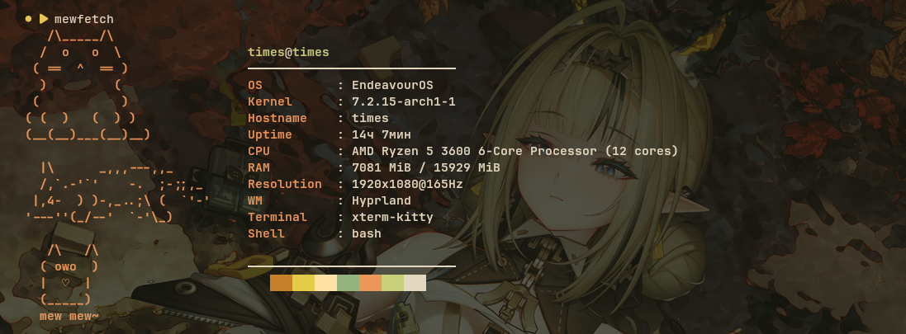

# 🐱 MewFetch

A lightweight, customizable system info fetch tool for Linux with a cat aesthetic.



## Features
- Pure Python 3 (no external dependencies like `neofetch` or `fastfetch`)
- Custom ASCII cat art
- Shows OS, Kernel, CPU, RAM, WM, and Resolution
- Colorful ANSI output matching your terminal theme

## Installation
```bash
git clone https://github.com/ТВОЙ_НИК/mewfetch.git
cd mewfetch
chmod +x mewfetch.py
./mewfetch.py
